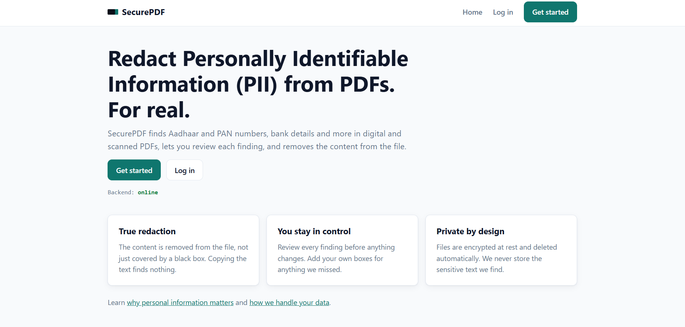
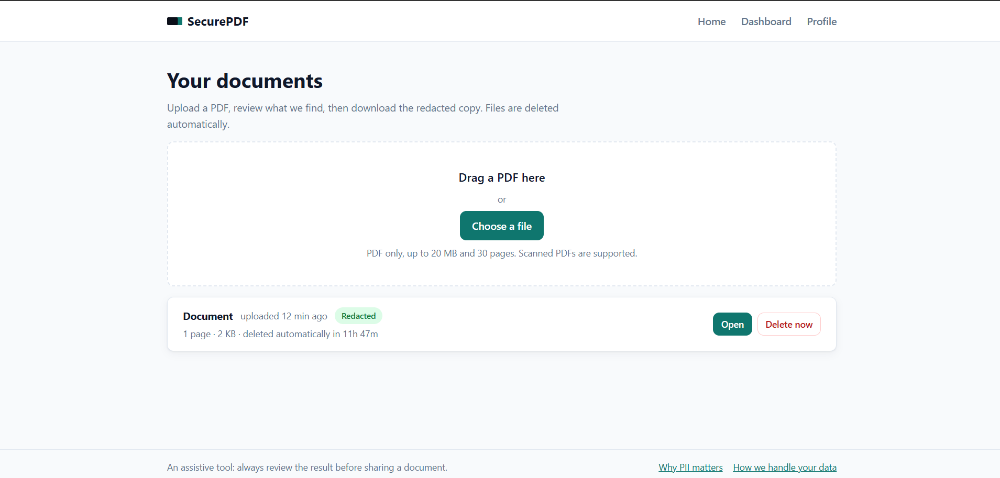
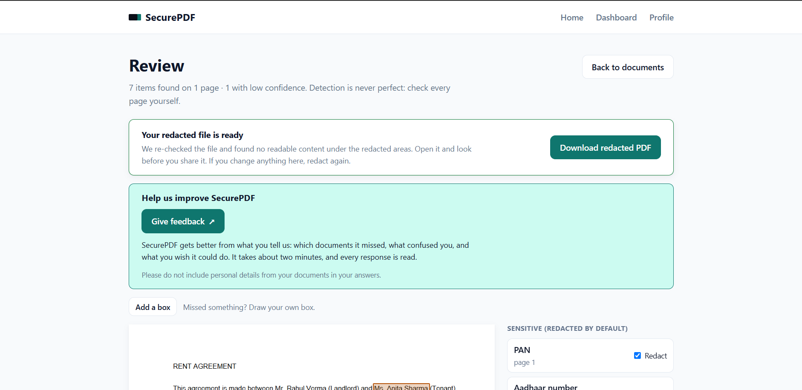
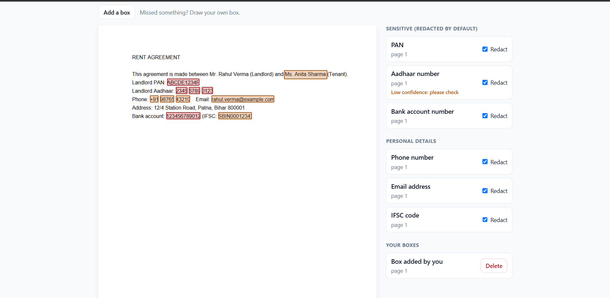
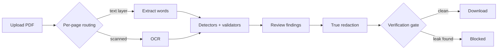

# SecurePDF

**Find and permanently remove personal information from digital and scanned PDFs, in English and Hindi.**

SecurePDF detects sensitive identifiers (Aadhaar, PAN, bank and card numbers and more), lets you review every finding, and produces a PDF where the underlying text is actually removed, not just covered by a black box. A verification step re-opens the output and refuses to release it if any redacted value can still be extracted.






## Why it exists

Drawing a black rectangle over text in a PDF hides it visually but leaves the text in the file, where anyone can copy it out. SecurePDF removes the content itself, and checks that it is gone before handing the file back.

## Features

- **Digital and scanned PDFs.** Each page is routed automatically: text-layer pages are read directly, scanned pages go through OCR (Tesseract, English + Hindi, 300 DPI), and mixed pages get both.
- **20 detectors for Indian and common identifiers**, using patterns, checksums (Verhoeff, Luhn, GSTIN) and context scoring:
  - Mandatory tier: Aadhaar, Aadhaar VID, PAN, passport, voter ID, driving licence, credit/debit card, bank account, CVV, UAN, ABHA
  - Recommended tier: email, phone, IFSC, GSTIN, UPI ID, vehicle registration, date of birth, IMEI
  - Optional tier: card expiry
- **Review before redacting.** Accept or reject each finding and draw manual boxes for anything the detectors did not catch.
- **True redaction.** Content is removed from the page, annotations and form fields are flattened first, and metadata is scrubbed.
- **Fail-closed verification.** The redacted file is re-read; if a removed value is still extractable, the download is blocked.
- **Hindi support**, including Devanagari digit normalisation.
- **Accounts and audit trail** for every action.

## How it works



## Privacy and security by design

- Files are encrypted at rest with AES-GCM envelope encryption; deleting a document destroys its key, which makes the stored bytes unrecoverable.
- Detected values are not stored in the database as plain text.
- Automatic retention purge removes documents after a configurable time.
- Passwords hashed with Argon2; sessions use httpOnly cookies (JWT).
- Upload limits (size and page count) are configurable.

## Tech stack

| Layer       | Tools                                                            |
| ----------- | ---------------------------------------------------------------- |
| Backend     | Python, FastAPI, SQLAlchemy 2, Alembic, Pydantic                 |
| PDF and OCR | PyMuPDF, Tesseract 5 (eng + hin), Pillow                         |
| Database    | MySQL                                                            |
| Security    | argon2-cffi, PyJWT, cryptography (AES-GCM)                       |
| Frontend    | React 19, Vite, React Router, react-pdf, plain CSS design tokens |
| Testing     | pytest, Vitest, Testing Library                                  |

## Project structure

```
backend/    FastAPI app, detection and redaction pipeline, migrations, tests
frontend/   React app (upload, review, redact, profile)
ml/         Evaluation tooling and data generators for the name/address research
samples/    Fake sample PDFs
docs/       Documentation and screenshots
```

## Run locally

Requirements: Python 3.11+, Node 20+, MySQL 8, Tesseract with the `eng` and `hin` language packs.

```bash
# 1. Backend
cd backend
python -m venv .venv && source .venv/bin/activate    # Windows: .venv\Scripts\activate
pip install -r requirements.txt
cp .env.example .env
# edit .env: DB credentials, SECRET_KEY, and FILE_ENCRYPTION_KEY, generated with:
python -c "import base64,os;print(base64.urlsafe_b64encode(os.urandom(32)).decode())"
alembic upgrade head
uvicorn app.main:app --reload --port 8000

# 2. Frontend (new terminal)
cd frontend
npm install
cp .env.example .env
npm run dev
```

Health check: `GET http://localhost:8000/api/health` returns `{"status":"ok"}`.

## Tests

```bash
cd backend  && python -m pytest
cd frontend && npm test
cd ml       && python -m pytest
```

## Evaluation

Detection of structured identifiers is rule-based and covered by unit tests, including checksum edge cases. For names and addresses, `ml/` contains a benchmark harness (exact and character-level precision/recall) with synthetic and realistic English/Hindi test documents, used to compare rule-based cues against a multilingual NER model (GLiNER) before integrating anything.

## Current scope

SecurePDF is assistive: it finds identifiers with well-defined formats and gives you a review step before anything is redacted. Free-text items such as names and addresses can be covered with manual boxes in this version. Uploads are limited to 30 pages and 20 MB.

## Licence

AGPL-3.0 (PyMuPDF is AGPL-licensed).

## Author

Pratham · [GitHub](https://github.com/pratham-bits)
